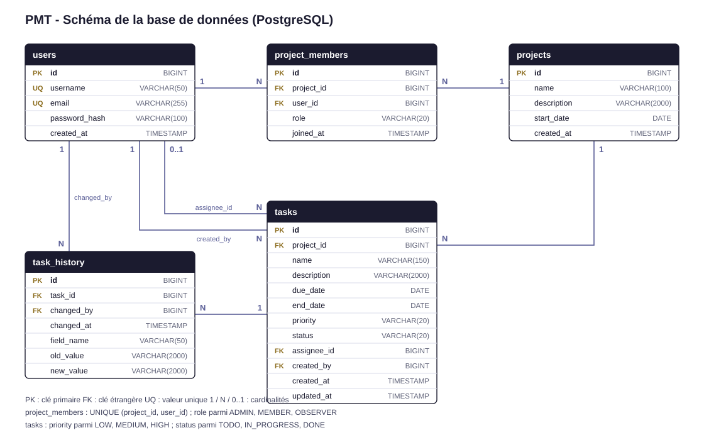
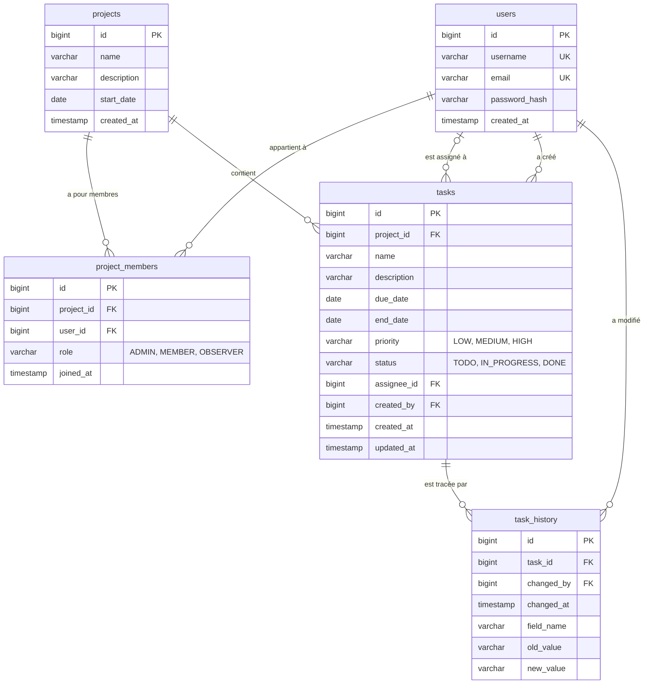

# Schéma de la base de données

Base PostgreSQL, créée par le script [`database/init.sql`](../database/init.sql) (structure et données de test).

## Le même schéma en Mermaid

## Les entités et ce qui les justifie

| Table | Rôle | User stories |
|---|---|---|
| `users` | Compte : nom d'utilisateur, e-mail, empreinte BCrypt du mot de passe | 1, 2 |
| `projects` | Projet : nom, description, date de début | 3 |
| `project_members` | Appartenance d'un utilisateur à un projet, avec son rôle | 3, 4, 5 |
| `tasks` | Tâche : nom, description, échéance, date de fin, priorité, statut, assigné, créateur | 6 à 10 |
| `task_history` | Une ligne par champ modifié : qui, quand, quel champ, ancienne et nouvelle valeur | 12 |

## Les choix de modélisation

- **Le rôle est porté par l'association `project_members`**, pas par l'utilisateur : la même personne peut
  être administratrice d'un projet et observatrice d'un autre. La contrainte `UNIQUE (project_id, user_id)`
  interdit d'ajouter deux fois quelqu'un au même projet.
- **Le créateur d'un projet** n'est pas une colonne de `projects` : c'est le premier membre, au rôle `ADMIN`.
  Un projet peut ainsi avoir plusieurs administrateurs, sans information en double.
- **L'assigné d'une tâche est facultatif** (`assignee_id` peut être nul) et l'application vérifie qu'il est
  membre du projet. Si son compte est supprimé, la tâche est conservée et redevient non assignée
  (`ON DELETE SET NULL`).
- **Rôle, priorité et statut** sont des chaînes limitées par une contrainte `CHECK` : la base refuse toute
  autre valeur, et les valeurs restent lisibles dans les requêtes.
- **L'historique** garde les valeurs sous forme de texte, ce qui permet de tracer n'importe quel champ avec
  une seule table. Il est supprimé avec sa tâche (`ON DELETE CASCADE`).
- **Les notifications par e-mail** (story 11) ne sont pas stockées : l'e-mail est envoyé au moment de
  l'assignation.

## Formes normales

- **1FN** : chaque colonne contient une seule valeur, chaque table a une clé primaire.
- **2FN** : toutes les clés primaires sont simples (`id`), donc aucun attribut ne dépend d'une partie de clé.
- **3FN** : aucun attribut ne dépend d'un autre attribut non clé. Le nom de l'assigné, par exemple, n'est
  pas recopié dans `tasks` : on le retrouve par `assignee_id`.

## Index

En plus des clés primaires et des contraintes d'unicité : `project_members (user_id)` pour lister les
projets d'un utilisateur, `tasks (project_id, status)` pour le tableau de bord, `tasks (assignee_id)` et
`task_history (task_id)`.
